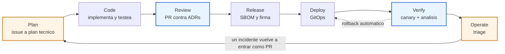

# architecture-harness-starter

> **Los agentes proponen, los gates deterministas deciden, los humanos son dueños de lo irreversible.**

Repo demo de la charla **"Harness engineering en todo el ciclo de vida CI/CD con agentes de IA"**.

Un servicio chico y real (`orders`: TypeScript, Node 22, Fastify) con el **harness completo
alrededor**: ADRs que se verifican en CI, políticas sobre los manifiestos, cinco subagentes con
permisos mínimos, hooks que bloquean de verdad, un pipeline por capas, y despliegue canary con
rollback automático. Todo corre en una laptop, con `make up`. Sin cuenta de nube.

---

## Qué es harness engineering

Un **harness** es el arnés: el conjunto de restricciones, verificaciones y contexto que hace que
un trabajo rápido además sea seguro. En una escalada, el arnés no te hace subir más rápido: hace
que la caída no sea el final.

**Harness engineering** es la disciplina de construir ese arnés alrededor del ciclo de vida del
software **para que agentes de IA puedan participar en todas las etapas sin que nadie tenga que
revisar cada línea a mano**.

El problema que resuelve es concreto. Un agente escribe código diez veces más rápido que una
persona; también toma atajos diez veces más rápido. El atajo típico no es malicioso, es literal:
importa el cliente de base de datos desde el dominio porque compila, baja un umbral porque el
test fallaba, pide un kubeconfig porque así arreglaría el incidente solo. La respuesta natural
—"revisemos todo con más cuidado"— no escala: si el cuello de botella es la revisión humana,
el agente no te dio velocidad, te dio deuda más rápido.

La respuesta de harness engineering es otra: **hacer que las restricciones sean ejecutables**. Si
la arquitectura importa, tiene que fallar un comando. Si un agente no debe desplegar, no tiene que
existir un camino al cluster. Si el canary no debe promoverse con un 30 % de errores, la decisión
no es de nadie: es de una consulta a Prometheus.

> **Aclaración:** no hablamos de [Harness.io](https://harness.io), la plataforma comercial de
> CI/CD. Acá "harness" es el concepto (arnés, armazón de pruebas), no el producto. Ninguna
> herramienta de este repo tiene relación con esa empresa.

---

## El principio rector

```
Los agentes proponen.
Los gates deterministas deciden.
Los humanos son dueños de lo irreversible.
```

Tres frases, tres consecuencias de diseño que están en todo este repo:

| | Qué significa | Dónde se ve |
|---|---|---|
| **Los agentes proponen** | La salida de un agente es un diff, un comentario o un PR. Nunca un cambio aplicado a producción. | `.claude/agents/*` — ninguno tiene herramientas de escritura sobre el cluster |
| **Los gates deciden** | Lo que pasa o no pasa lo define una herramienta, no una opinión ni un modelo. Mismo resultado en la laptop y en CI. | `npm run verify`, `policy/*.rego`, el `AnalysisTemplate` |
| **Los humanos lo irreversible** | Mergear a `main`, promover a producción, definir la política de rollback: de personas. | branch protection, `.claude/hooks/*` |

El corolario práctico: **un agente que se equivoca produce un PR malo**, que es exactamente el
riesgo que el pipeline ya está construido para contener.

---

## El ciclo



La flecha que importa es la de vuelta: **un incidente vuelve a entrar como PR**. No como un
`kubectl` a las 3 de la mañana, no como un mensaje en un canal que nadie va a volver a leer. Como
un PR con su causa raíz, su test de regresión y, cuando corresponde, **un guardrail nuevo** para
que esa clase de error no pueda volver. Eso es cerrar el ciclo.

---

## Quién hace qué en cada etapa

| Etapa | Agente | Dónde corre | Gate | Humano |
|---|---|---|---|---|
| **Plan** | Convierte el issue en plan técnico y lo valida contra ADRs | Sandbox, solo lectura | Plan aprobado | Aprueba la intención |
| **Code** | Implementa y escribe tests | Sandbox efímero, sin secretos | Tests + fitness functions | — |
| **Review** | Revisa el PR contra ADRs y seguridad | Runner efímero | Policy-as-code (OPA) | Aprueba el merge |
| **Release** | Changelog; el pipeline firma y genera SBOM | Pipeline | Firma verificada | — |
| **Deploy** | Ninguno: lo hace GitOps | Argo CD | Canary con análisis | Promueve o define la política |
| **Verify** | Analiza métricas del canary y explica | Solo lectura | Rollback automático | Revisa casos dudosos |
| **Operate** | Triage y propuesta de fix | Solo lectura en prod | El fix entra como PR | Decide y aprende |

Fijate en la columna **Gate**: en ninguna etapa el gate es "el agente dijo que está bien".

---

## Las 5 capas del harness

### 1. Contexto — que el agente sepa dónde está parado

Un agente sin contexto adivina, y adivina con mucha seguridad. El contexto no es un prompt largo:
son archivos versionados que viven con el código.

- [`CLAUDE.md`](CLAUDE.md) — reglas del proyecto, comandos de verificación, convenciones, y las
  diez reglas duras.
- [`docs/adr/`](docs/adr/) — las decisiones de arquitectura, **cada una con su sección
  "Verificación"** que dice qué comando la comprueba.
- [`.claude/agents/`](.claude/agents/) — qué hace cada agente y, sobre todo, **qué no hace**.

> Un ADR sin sección "Verificación" no es un ADR: es una opinión.

### 2. Guardrails deterministas — que las reglas fallen solas

| Qué | Comando | Verifica |
|---|---|---|
| Fitness functions | `npm run arch:check` | ADR-001 y ADR-002 (dependency-cruiser) |
| Policy-as-code | `npm run policy` | manifiestos de k8s (OPA/Conftest) |
| Tests | `npm test` | comportamiento, incluido el contrato de métricas |
| Tipos y lint | `npm run typecheck`, `npm run lint` | lo barato que atrapa mucho |
| Hooks | `make test-hooks` | que los guardrails de agentes bloqueen de verdad |
| **Todo junto** | **`npm run verify`** | **lo mismo que corre CI** |

Lo importante no es la lista: es que **el mismo comando corre en la laptop, en CI y en la sesión
del agente**. Un gate que solo existe en CI enseña a la gente a pushear para ver si pasa.

### 3. Agentes en el pipeline — cinco, con scope mínimo

| Agente | Puede | Nunca |
|---|---|---|
| [`architect-reviewer`](.claude/agents/architect-reviewer.md) | `Read`, `Grep` | editar código, aprobar PRs |
| [`test-writer`](.claude/agents/test-writer.md) | `Read`, `Write` solo en `/test` | tocar código de producción |
| [`release-notes`](.claude/agents/release-notes.md) | `Read`, `git log` | publicar releases |
| [`canary-analyst`](.claude/agents/canary-analyst.md) | solo lectura (Prometheus, Rollout) | promover ni abortar |
| [`incident-triage`](.claude/agents/incident-triage.md) | leer logs/métricas, crear rama + PR | tocar el cluster |

Por qué el scope mínimo no es paranoia: si `test-writer` pudiera tocar `src/`, cada PR suyo habría
que leerlo completo, porque podría haber "arreglado" el código para que su test pase. Como no
puede, su diff se revisa en treinta segundos. **El permiso mínimo no limita al agente: libera al
revisor.**

### 4. Evals — medir el harness, no solo el modelo

La pregunta no es "¿qué tan bueno es el agente?" sino **"¿qué tan bien atrapa mis gates lo que el
agente hace mal?"**.

Este repo trae el eval más simple y más útil que existe: **el Acto 1 de la demo**. Es un caso
conocido de violación de arquitectura, y el resultado esperado es que `arch:check` falle con un
mensaje concreto. Si un día deja de fallar, el harness se rompió.

Lo mismo con [`scripts/test-hooks.sh`](scripts/test-hooks.sh): 22 casos que verifican que los
guardrails bloquean (`make test-hooks`). **Un guardrail que nadie testea es una decoración.**

Cómo escalarlo en tu equipo: guardá cada error real de un agente como un caso. En seis meses
tenés una suite que te dice si tu harness sigue funcionando, con ejemplos que importan de verdad
porque pasaron.

### 5. Permisos y aislamiento — que lo peligroso no esté al alcance

- **Cero credenciales de producción para agentes** ([ADR-003](docs/adr/003-no-agent-prod-creds.md)).
- **Hooks deterministas** en [`.claude/hooks/`](.claude/hooks/): scripts, no instrucciones. Un
  `exit 2` no se negocia con el modelo.
- **Credenciales efímeras** en CI: OIDC y `GITHUB_TOKEN` por job, `permissions` mínimos. El único
  secreto permanente es `ANTHROPIC_API_KEY`, y solo habilita comentar en un PR.
- **Firma keyless** con cosign: no existe una llave privada que robar.
- **Sandboxes efímeros** para correr agentes (ver más abajo).

---

## Correrlo todo en 10 minutos

### Requisitos

| Herramienta | Versión mínima | Para qué |
|---|---|---|
| **Docker** | 24+ | construir la imagen y correr kind |
| **kind** | 0.20+ | el cluster local |
| **kubectl** | 1.27+ | hablarle al cluster |
| **Node** | **22** | la app y los gates |
| **git** + **gh** | — | GitOps y el PR del Acto 3 |
| helm | 3+ (opcional) | no hace falta: todo se instala con `kubectl apply` |

Opcionales (si no están, se usan vía Docker o se saltean):

- `conftest` → si falta, [`scripts/conftest.sh`](scripts/conftest.sh) usa
  `docker run openpolicyagent/conftest`.
- plugin `kubectl argo rollouts` → `make install-rollouts-plugin`. Sin él la demo funciona, pero
  se ve mucho peor: **instalalo antes de la charla.**

### Argo CD lee de GitHub: necesitás tu propio repo

Este repo usa **GitOps de verdad**: Argo CD sincroniza desde un repositorio Git remoto, no desde
tu disco. O sea que para desplegar necesitás tu propio repo:

```bash
gh repo create architecture-harness-starter --public --source=. --push
```

`make up` detecta tu remoto y tu rama actual (`git remote get-url origin`), así que no tenés que
editar ningún YAML. Si querés apuntar a otro lado:

```bash
make up GIT_REPO_URL=https://github.com/tu-usuario/tu-fork.git GIT_BRANCH=main
```

### Los 10 minutos

```bash
# 1. Gates deterministas (30 segundos, sin cluster)
npm ci
npm run verify          # lint + typecheck + tests + arch:check + policy
make test-hooks         # los guardrails bloquean de verdad

# 2. Todo el CD local (6-8 minutos la primera vez)
make up                 # kind + Argo CD + Argo Rollouts + Prometheus + la app

# 3. Mirar
make rollout-status     # el Rollout 'orders'
make argocd-ui          # https://localhost:8080  (make argocd-password)
make prom-ui            # http://localhost:9090
make smoke              # pegarle al servicio

# 4. La demo
bash demo/act1-arch-violation.sh
bash demo/act2-canary-catches-bug.sh
bash demo/act3-close-the-loop.sh
bash demo/reset.sh      # repetir desde cero

# 5. Limpiar
make down               # borra el cluster y todo lo que creamos
```

`make help` lista todos los targets.

---

## Aprobación humana (branch protection)

El gate humano no se implementa con un job de CI: se implementa con **branch protection**. El job
`9 · aprobacion humana` del pipeline solo lo hace visible.

```bash
gh api -X PUT "repos/{owner}/{repo}/branches/main/protection" \
  --input - <<'JSON'
{
  "required_status_checks": {
    "strict": true,
    "contexts": [
      "1 · lint [determinista]",
      "2 · tests [determinista]",
      "3 · arch:check [determinista]",
      "4 · conftest [determinista]",
      "5 · build de imagen [determinista]",
      "6 · SBOM (syft) [determinista]"
    ]
  },
  "enforce_admins": true,
  "required_pull_request_reviews": {
    "required_approving_review_count": 1,
    "dismiss_stale_reviews": true,
    "require_code_owner_reviews": false
  },
  "restrictions": null,
  "allow_force_pushes": false,
  "allow_deletions": false
}
JSON
```

Lo que importa de esa configuración:

- **`ai-review` no está en `required_status_checks`.** A propósito. Un agente no bloquea un merge;
  tampoco lo habilita.
- **`required_approving_review_count: 1`.** Una persona aprueba. Siempre.
- **`enforce_admins`.** En tu repo real: **`true`**. Si los admins pueden saltear el gate, el
  gate es decorativo.

  En **este** repo de demo queda en `false`, y conviene decir por qué en voz alta: con un solo
  colaborador, GitHub no te deja aprobar tu propio PR, así que `enforce_admins: true` +
  `required_approving_review_count: 1` hace que **nada se pueda mergear nunca**, ni siquiera por
  vos. Eso no es seguridad: es un repo tapiado. En cuanto haya una segunda persona en el equipo,
  subilo a `true`:

  ```bash
  gh api -X PATCH "repos/{owner}/{repo}/branches/main/protection/enforce_admins"
  ```

  Es el ejemplo más limpio de algo que vale para todo el harness: **un gate que no se puede
  cumplir se termina desactivando**, y un gate desactivado es peor que no tenerlo, porque genera
  la sensación de estar protegido.
- **`allow_force_pushes: false`.** Sin esto, la historia es negociable.

El único secreto que hay que configurar:

```bash
gh secret set ANTHROPIC_API_KEY     # solo habilita comentar en PRs
```

### Firma con llave (si no podés usar keyless)

El pipeline firma con **cosign keyless**: la identidad viene del token OIDC de GitHub Actions y la
firma queda en el log público de transparencia (Rekor). No hay llave privada. Si tu organización no
puede usar Fulcio/Rekor públicos:

```bash
# 1. Generar el par de llaves (una vez, en una máquina de confianza)
cosign generate-key-pair

# 2. Guardar la privada y su password como secretos del repo
gh secret set COSIGN_PRIVATE_KEY < cosign.key
gh secret set COSIGN_PASSWORD

# 3. En el job `sign` del workflow, reemplazar:
#      cosign sign --yes "$REF"
#    por:
#      cosign sign --yes --key env://COSIGN_PRIVATE_KEY "$REF"
#    y publicar cosign.pub para que cualquiera pueda verificar.
```

El costo de esa variante es exactamente lo que el ADR-003 quiere evitar: **ahora existe un secreto
permanente que hay que rotar, auditar y custodiar**. Si podés usar keyless, usalo.

---

## Agentes en sandbox efímeros

Un agente no debería correr con tu usuario, tu red y tus credenciales. El objetivo es que, si el
agente se equivoca o si alguien le inyecta instrucciones en un issue, **el daño máximo esté
acotado por el contenedor**, no por el buen criterio del modelo.

```bash
# Red aislada, solo con lo que el agente realmente necesita alcanzar.
docker network create --internal agent-net 2>/dev/null || true

docker run \
  --rm \                                  # efímero: se destruye al terminar
  --name agente-$(date +%s) \
  --network agent-net \                   # red interna, sin salida a internet
  --read-only \                           # filesystem de solo lectura
  --tmpfs /tmp:rw,noexec,nosuid,size=256m \
  --tmpfs /home/agente/.cache:rw,size=256m \
  --user 10001:10001 \                    # usuario no root, sin cuenta en el host
  --cap-drop ALL \                        # ninguna capability de Linux
  --security-opt no-new-privileges \      # no puede escalar con setuid
  --security-opt seccomp=default \
  --pids-limit 256 \                      # no puede hacer fork bomb
  --memory 2g --cpus 2 \                  # presupuesto acotado
  -v "$PWD:/work:ro" \                    # el código, SOLO LECTURA
  -v agent-out:/out \                     # el diff sale por acá
  -w /work \
  -e ANTHROPIC_API_KEY \                  # del entorno, NO montado como archivo
  mi-imagen-de-agente:1.0 \
  claude -p "Implementá el issue #42. Escribí el diff en /out/cambio.patch"
```

Las decisiones que importan, y por qué:

| Flag | Qué impide |
|---|---|
| `--rm` | que quede estado entre corridas (y por lo tanto contaminación entre tareas) |
| `--network agent-net` (interna) | exfiltrar código o datos a internet; una red `--internal` no tiene gateway |
| `--read-only` + `--tmpfs` | persistir un backdoor en la imagen o en el filesystem |
| `--user 10001:10001` | escribir como root, incluso en un volumen mal montado |
| `--cap-drop ALL`, `no-new-privileges` | escalar privilegios dentro del contenedor |
| `-v $PWD:/work:ro` | que el agente modifique tu working copy directamente: **su salida es un patch** |
| `-e ANTHROPIC_API_KEY` (del entorno) | que la llave quede en un archivo que el agente pueda leer, loguear o mandar |
| `--pids-limit`, `--memory`, `--cpus` | que un loop te tire la laptop (o el runner) |

### Credenciales de vida corta

**Nunca montes un `.env` ni un kubeconfig en el contenedor del agente.** Si el agente necesita
autenticarse, que reciba un token que expira:

- En CI: OIDC (`id-token: write`) y `GITHUB_TOKEN` por job, con `permissions` mínimos. Expira con
  el job.
- Para cloud: *workload identity federation* / `AssumeRoleWithWebIdentity` con TTL de minutos, no
  llaves estáticas.
- Para leer métricas: un token de solo lectura con TTL corto, scope a un namespace. Como
  `canary-analyst`, que solo puede `get`.
- Regla práctica: **si la credencial sobrevive al contenedor, está mal.**

### Si necesitás más aislamiento que un contenedor

Un contenedor comparte el kernel con el host: un escape de kernel te deja afuera del arnés. Si el
agente corre código no confiable (y el código que escribe un agente es, por definición, no
revisado todavía), vale la pena una frontera más fuerte:

| Opción | Qué hace | Costo |
|---|---|---|
| **[gVisor](https://gvisor.dev)** (`runsc`) | Intercepta las syscalls en un kernel en espacio de usuario: el kernel real casi no se toca. Es un `--runtime=runsc` en Docker. | 10-30 % de overhead en syscalls intensivas; algunas syscalls no soportadas |
| **[Kata Containers](https://katacontainers.io)** | Cada contenedor es una microVM con su propio kernel; interfaz igual a la de un contenedor (OCI/CRI). | ~100-200 ms más de arranque, más RAM por sandbox |
| **[Firecracker](https://firecracker-microvm.github.io)** | microVM minimalista (lo que usa AWS Lambda): arranque ~125 ms, superficie de ataque chiquísima. Lo más fuerte de los tres. | Hay que construir la integración; no es un drop-in de Docker |

Regla de decisión simple: **para agentes que solo leen tu código, un contenedor bien configurado
alcanza. Para agentes que ejecutan código que ellos mismos escribieron, usá una frontera de
kernel** (gVisor como primer paso, microVM si el riesgo lo justifica).

---

## Mapa del repo

```
.
├── CLAUDE.md                    contexto del proyecto para los agentes
├── HARNESS-CHECKLIST.md         niveles 0-3 de madurez + "Mañana en tu equipo"
├── Makefile                     make up / make down / make verify / actos
├── Dockerfile                   multi-stage, distroless, non-root
├── .dependency-cruiser.js       fitness functions: los ADRs ejecutables
│
├── src/
│   ├── domain/                  reglas de negocio puras + PUERTOS
│   ├── application/             casos de uso (solo conocen puertos)
│   ├── infrastructure/          ADAPTADORES (repo, métricas, config)
│   └── http/                    Fastify + composition root
├── test/                         vitest
│
├── docs/adr/
│   ├── 001-domain-pure.md       el dominio es puro
│   ├── 002-ports-adapters.md    puertos y adaptadores
│   └── 003-no-agent-prod-creds.md  ningún agente despliega
│
├── policy/                      OPA/Conftest sobre los manifiestos
├── deploy/
│   ├── k8s/                     lo que Argo CD sincroniza (Rollout, AnalysisTemplate, …)
│   ├── argocd/                  la Application (plantilla)
│   └── monitoring/              Prometheus mínimo (1 pod)
│
├── demo/                        los 3 actos + DEMO.md + reset
├── scripts/                     conftest, prom-query, test-hooks
│
├── .claude/
│   ├── agents/                  los 5 subagentes
│   ├── hooks/                   los guardrails (scripts, no prompts)
│   └── settings.json            PreToolUse + permissions
└── .github/workflows/ci.yml     el pipeline por capas
```

---

## Cómo adaptarlo a tu equipo

No copies el repo: copiá los movimientos, en este orden. Cada paso vale por sí solo.

**1. Escribí un `CLAUDE.md` y UN ADR verificable.** Uno, no doce. Elegí el límite que más te
duele cuando se rompe (el dominio, la capa de datos, el borde entre servicios) y escribilo con su
sección **"Verificación"** que nombre un comando. Si no podés escribir ese comando, el ADR todavía
no está listo.

**2. Convertí ese ADR en una regla.** Si usás TypeScript, [`.dependency-cruiser.js`](.dependency-cruiser.js)
te sirve casi tal cual. Para otros stacks, el equivalente:

| Stack | Herramienta |
|---|---|
| Java / Kotlin | ArchUnit |
| .NET | NetArchTest |
| Python | import-linter |
| Go | go-arch-lint, `depguard` |
| Cualquiera | un test que falle si un grep encuentra el import prohibido — sirve más de lo que parece |

**3. Quitale a tus agentes las credenciales permanentes.** Hoy. Es el cambio con mejor relación
entre esfuerzo y riesgo evitado de toda esta lista. Empezá por buscar qué `.env` se está montando
en tus runners.

**4. Poné el review de IA DESPUÉS de los gates deterministas, y que no bloquee.** Como en
[`ci.yml`](.github/workflows/ci.yml). Si una herramienta ya dijo "esto está mal" con precisión, no
necesitás un modelo para repetirlo con menos precisión.

**5. Un canary con análisis automático, aunque sea con una sola métrica.** La tasa de error
alcanza. El valor no está en el dashboard: está en que **nadie tenga que mirar el dashboard para
que el rollback ocurra**.

**6. Instalá la costumbre que lo mantiene vivo:** cada vez que un agente se equivoque de una forma
nueva, **convertí ese error en una regla de CI antes de mergear el fix**. Es la única práctica de
esta lista que mejora el harness con el tiempo en vez de dejarlo envejecer.

Para medir dónde estás y qué sigue: [`HARNESS-CHECKLIST.md`](HARNESS-CHECKLIST.md).

---

## Lo que ya está listo en este repo

Si clonaste este repo tal cual (no un fork tuyo), esto ya existe y sirve como referencia de que
todo esto funciona de verdad:

| Qué | Dónde |
|---|---|
| Pipeline verde en `main`, con firma cosign keyless verificada | [Actions](https://github.com/falconcr/architecture-harness-starter/actions) |
| **Run fallido grabado** del Acto 1 (`arch:check` en rojo) | [run 40566426718](https://github.com/falconcr/architecture-harness-starter/actions/runs/40566426718) · [PR #1](https://github.com/falconcr/architecture-harness-starter/pull/1) |
| **PR del Acto 3** (el fix + test de regresión + guardrail nuevo) | [PR #4](https://github.com/falconcr/architecture-harness-starter/pull/4) |
| Salida real del canary fallando | [`demo/act2-output.txt`](demo/act2-output.txt) |

Los PRs #1 y #4 están **abiertos a propósito**: son el plan B de la demo. No los mergees ni los
cierres si vas a dar la charla con este repo.

Para tu propio fork: `gh repo create architecture-harness-starter --public --source=. --push` y
después seguí [`demo/DEMO.md`](demo/DEMO.md), que explica cómo regenerar los dos.

---

## Licencia

MIT. Usalo, forkealo, adaptalo, dalo en tu propia charla.
